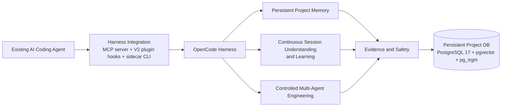

# OpenCode Harness

> Hermes-inspired capabilities for existing AI coding-agent harnesses.

A local, project-scoped intelligence layer that plugs into the coding agent you already use. It gives that agent persistent memory, continuous session understanding and learning, and a controlled way to plan and coordinate multi-agent engineering work.

**Readiness — stated plainly:** Conditionally ready with documented limitations for the tested local deployment scope. Real Harness-dispatched OpenCode agent execution was **not demonstrated in Phase 28**. The approval and simulation control paths were tested, but a fresh Harness-dispatched agent task, agent response, and postcondition verification were **not** proven with new execution. This is not a claim of universal production readiness.

---

## What is this, and what problem does it solve?

Coding agents are, by default, stateless between sessions. The decision you made last week, the convention your team uses, the debugging fix that actually worked, and the unfinished task from yesterday are gone unless someone repeats them. At the same time, doing larger work with several agents needs a way to split tasks, hand off context, avoid file conflicts, and — critically — require explicit human approval before anything is dispatched.

The OpenCode Harness is a sidecar that sits next to your coding agent and addresses those gaps:

- It **remembers** verified project decisions, conventions, and context across sessions, isolated per project.
- It **learns** from real session evidence (goals, tasks, debugging attempts, verified fixes) rather than from assistant claims.
- It **plans and coordinates** multi-agent work, but leaves execution to the host agent and never dispatches without single-use approval.

It is an extension, not a replacement. See [How it works with your coding agent](#how-it-works-with-your-coding-agent).

## The three core capabilities

1. **Persistent Project Memory** — decisions, relationships, project context, memory lifecycle, and hybrid (full-text + vector) retrieval with quality ranking. Retrieved memories are labeled untrusted historical reference data, never instructions.
2. **Continuous Session Understanding and Learning** — durable transcripts, evidence-graded session understanding, goals and tasks, debugging experience, reusable learning records, feedback, and an idempotent turn-end learning pipeline. Only observed evidence can promote a claim toward verified.
3. **Controlled Multi-Agent Engineering** — task decomposition, agent discovery and coordination, project-scoped context ledgers and file ownership, result validation, and a workflow state machine whose default mode is `simulation`. Dispatch requires an explicit, single-use approval token bound to the plan, scope, mode, and risk.

Two supporting layers compose these capabilities rather than competing with them: **source-level engineering intelligence** (heuristic, *no AST parser*) and **operational health / diagnostics**.

## How it works with your coding agent

**The host agent remains the execution environment. The Harness extends it — it does not replace it.**

The Harness does not modify your agent's source, security policy, or system prompt. It connects through supported interfaces:

- an **MCP server** (`opencode-memory`, in `engine/src/server.js`) exposing tool families such as `memory_*`, `learning_*`, `project_*`, `workflow_*`, `code_*`, `pm_*`, `adapt_*`, `ops_health`, and `agent_*`;
- a **sidecar CLI** (`engine/src/cli.js`) used by the plugin and directly from a terminal (commands such as `status`, `context`, `learn`, `automate`, `agent-plan`, `workflow-*`, `ops-health`);
- an optional **OpenCode V2 plugin** (`plugin/memory.ts`) that injects retrieved context on prompts and runs the turn-end learning pipeline;
- an optional local **dashboard** for inspection.

Execution of work is handed to the host agent's supported interfaces (for example OpenCode's `run`/subagent capabilities). Generic MCP clients can call the tools but do **not** inherit the host agent's autonomous capabilities.



## Supported platforms and prerequisites

| Item | Requirement / tested version |
|---|---|
| Host agent | OpenCode (primary host, **v2.4.1** tested). Generic MCP SDK clients are experimental. |
| Runtime | Node.js (**v26.5.0** tested); the engine is an ESM package (`opencode-memory-engine` v0.1.0). |
| Database | PostgreSQL 17 with `pgvector` and `pg_trgm` (Docker Compose provided). Fresh migrations `init/001`–`026`; no development dump is shipped. |
| Embeddings | Optional local Ollama (`nomic-embed-text`, 768 dims). No paid embedding API required. |
| OS / paths | Cross-platform at the code level, but several defaults in the current source are Windows-specific and must be overridden via environment variables (for example `HARNESS_OPENCODE_DB`, `SQLITE3`, `HARNESS_OPENCODE_BIN`). |

## Install (short form)

The installer lives in `installer/bootstrap/`. It shows a plan, requires confirmation, supports `--dry-run`, is idempotent, backs up any file it modifies, and never overwrites unrelated files.

```powershell
node installer/bootstrap/install.mjs --target <project-dir> --capabilities memory,learning,agents --dry-run
node installer/bootstrap/install.mjs --target <project-dir> --capabilities memory,learning,agents --apply --yes
```

See [INSTALL.md](INSTALL.md) for every mode and the full bootstrap procedure, and [QUICKSTART.md](QUICKSTART.md) for a first working session.

## Safety guarantees

These are preserved by design and verified in tests; do not weaken them when configuring an installation.

- Autonomy stays at **LEVEL 1** (`OPTIMIZATION_LEVEL=1`); semantic LLM interpretation is off by default (`HARNESS_SEMANTIC_LLM=0`).
- **No auto-approval.** Multi-agent dispatch requires an explicit, single-use approval bound to project, plan id/version/hash, scope, mode, and risk. `workflow-dispatch` defaults to `dry-run: true`.
- **Project isolation.** Memories and learning are project-scoped; global promotion requires explicit eligibility.
- **No source rewrite, no unrestricted execution.** The Harness plans, coordinates, supplies context, validates, and learns; it does not rewrite your source.
- **Untrusted data boundary.** Retrieved memory and transcripts are data, never instructions. A redaction layer strips secrets before storage; queries are parameterized; paths are containment-checked.
- **Evidence tiers stay distinct** (`mock`, `api`, `runtime`, `agent`). `process_ok` never implies `task_verified`.

The Phase 28 hardening review found no confirmed exploitable vulnerability in the tested scope; presence-only wiring audits are explicitly **not** runtime verification. Four inherited regression anomalies remain documented.

## Documentation

- [INSTALL.md](INSTALL.md) — prerequisites, installer modes, bootstrap, database migration path, uninstall.
- [QUICKSTART.md](QUICKSTART.md) — first working session with real commands.
- [Getting started](docs/getting-started.md) — concepts and a guided first use.
- [Architecture](docs/architecture.md) — how the layers compose and where data lives.
- [Capabilities](docs/capabilities.md) — the three capabilities mapped to real modules, CLI commands, and MCP tools.
- [FAQ](docs/faq.md) — honest limitations and common questions.

## Repository status

This project is licensed under the **Apache License 2.0** — see [LICENSE](LICENSE). Source visibility is not reuse permission; the license grants the reuse terms.

The published repository is `Aliahasan399/opencode-hermes-harness` (public, default branch `main`). The project is **conditionally ready with documented limitations for the tested local deployment scope**; real Harness-dispatched OpenCode agent execution was not demonstrated. See [SECURITY.md](SECURITY.md) and [docs/compatibility.md](docs/compatibility.md).
