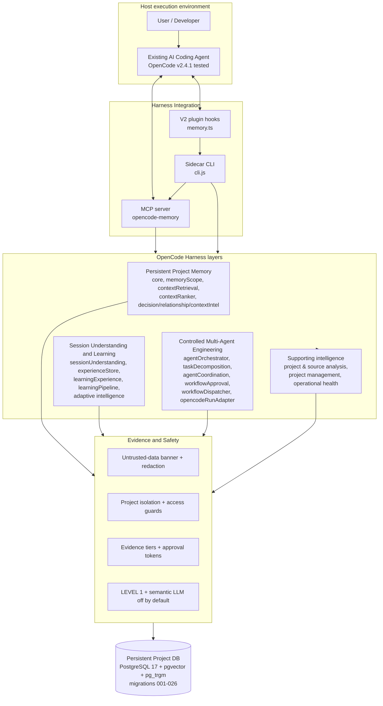
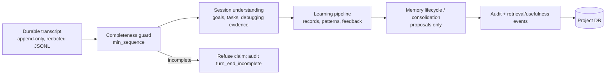
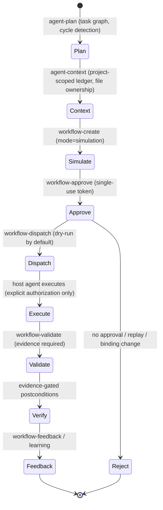

# Architecture

This document describes the OpenCode Harness as a composed system: a set of additive layers built on one project-scoped PostgreSQL database, connected to an existing coding agent through supported interfaces. It is organized by function rather than by development history; the phase numbers below appear only as provenance labels for the additive migrations and module groups.

> Readiness: conditionally ready with documented limitations for the tested local deployment scope. Real Harness-dispatched OpenCode agent execution was not demonstrated in Phase 28. Wiring audits are presence-only and are not runtime verification.

## Design principles

1. **Extension, not replacement.** The host agent executes work. The Harness plans, remembers, learns, validates, and reports.
2. **Additive only.** New capabilities arrive as new modules and additive migrations (through `init/026-phase28-hardening.sql`). No competing memory, learning, risk, or workflow engine is introduced; existing systems are reused.
3. **Evidence over claims.** Assistant statements are candidates. Only tool evidence, explicit user feedback, and verified outcomes can promote a claim. Evidence classes stay distinct.
4. **Fail closed on safety.** LEVEL 1 autonomy, single-use approvals, project isolation, parameterized queries, path containment, and secret redaction are defaults.
5. **Independent degradation.** Optional components (semantic LLM, vector search, adaptive modules) fail open or no-op; basic memory save/search/retrieve always remain available.

## Component map

| Component | Location | Role |
|---|---|---|
| MCP server | `engine/src/server.js` | Exposes tool families to the host agent over stdio: `memory_*`, `learning_*`, `project_*`, `workflow_*`, `code_*`, `pm_*`, `adapt_*`, `ops_health`, `agent_*`. |
| Sidecar CLI | `engine/src/cli.js` | Flat command set for the plugin and terminal use. Same engine modules, no separate implementation. |
| Engine modules | `engine/src/*.js` | ~111 modules behind facades such as `projectManagement.js`, `controlledWorkflow.js`, `codeIntelligence.js`, `adaptiveIntelligence.js`, `operationalHealth.js`. |
| OpenCode plugin | `plugin/memory.ts` | V2 hooks: prompt-time context injection, turn-end pipeline, durable transcript appends. |
| Database | PostgreSQL 17 + `pgvector` + `pg_trgm` | Structured memory, full-text + vector + trigram retrieval, all project-scoped. |
| Embeddings | Optional local Ollama (`nomic-embed-text`, 768 dims) | No paid embedding API required. |
| Dashboard | `dashboard/server.js` | Local inspection UI on a loopback port. |
| Installer | `installer/bootstrap/` | Plan-first, confirmation-gated config and capability wiring. |

## Layered view



## Request lifecycle (prompt time)

When the plugin is active, the same automatic path runs on every prompt:

```mermaid
sequenceDiagram
  participant U as User
  participant A as Host Agent
  participant P as Plugin hook (prompt)
  participant C as CLI context-package
  participant R as Retrieval + ranker
  participant B as Injection budget/audit
  participant D as Project DB

  U->>A: prompt
  A->>P: prompt hook
  P->>C: prepareContext(query, project, budget)
  C->>R: classify task; retrieveTaskContext()
  R->>D: hybrid + project context + decisions (scoped)
  D-->>R: candidates
  R->>R: filter quality/contradiction/superseded; rerank
  R-->>C: budgeted context block
  C->>B: redact, add untrusted-data banner, log content-free audit
  B-->>P: context string
  P-->>A: inject into system context
  A-->>U: answer (host agent executes)
```

Key points: retrieval is scoped and budgeted; the entire database is never injected; identical requests are cached in a strictly isolated TTL cache; the injection audit records no content. If a new component is unavailable, basic retrieval still works.

## Turn-end lifecycle (learning)



The pipeline is idempotent and recoverable. Stale claims are reset, pending/failed events retried, and older pending events superseded when a newer sequence completed — an event is never marked done without being run. Assistant claims never become verified without tool evidence.

## Controlled multi-agent flow



`process_ok` never sets `task_verified`. A real process exit or an agent reply is not attributed to a Harness task without evidence. No fresh real dispatch was demonstrated in Phase 28.

## Data architecture

- **Migration chain:** `init/001-init.sql` through `init/026-phase28-hardening.sql`, all additive. Migration 026 adds eight reversible `project_id` indexes on high-traffic tables (agent execution/review, workflow verification/dispatch, learning runs, memory retrieval events, optimization recommendations, learning activity). No migration tracking table exists.
- **Table groups:** core memory and history; patterns, strategies, and consolidation; automation events and durable transcripts; project context, decisions, and relationships; session understanding, goals, tasks, and learning records; agent plans/executions/reviews; workflow approvals/runs/tasks/dispatches/verifications; project health and management; source index/symbol graph/test map; adaptive calibration; operational health.
- **Isolation:** `project_id` is carried on project-scoped rows. `memoryScope.js` enforces global eligibility; MCP tools such as `memory_get`, `memory_list`, and `memory_session_detail` enforce project scope; admin paths require explicit `admin === true` and are audited by ids/reason only.
- **Retrieval:** PostgreSQL `websearch_to_tsquery` full-text search plus pgvector cosine similarity, fused by reciprocal-rank fusion, filtered by project/validity, then compacted to a budgeted context block. Ranking labels are transparent (verification, lifecycle, provenance, explicit vs inferred usefulness, strategy effectiveness); retrieval frequency is not a trust boost.

## Safety architecture

| Control | Implementation |
|---|---|
| Parameterized queries | SQL values bound as data; injection strings cannot alter queries (`memory` table unchanged under adversarial tests). |
| Path containment | `underRoot()` checks on filesystem paths. |
| Secret hygiene | Redaction of keys/tokens/private keys and `password=`/`token=` patterns before storage; credentials read only from an env var named by configuration, never from agent auth files. |
| Untrusted evidence | Memory/transcript content treated as data; source-comment injection cannot grant authority. |
| Approval | Token hash stored, atomic single-use consumption, replay and binding-change rejection, including under concurrent consumption. |
| Source integrity | No source rewrite; no shell interpolation in the dispatch adapter; no unrestricted execution. |
| Autonomy | `OPTIMIZATION_LEVEL=1`, `HARNESS_SEMANTIC_LLM=0`; no auto-approval. |

## Interfaces inventory (verified names)

- **MCP tool prefixes** (`engine/src/server.js`): `memory_status`, `memory_search`, `memory_save`, `memory_update`, `memory_get`, `memory_list`, `memory_delete`, `learning_*`, `project_*`, `workflow_*`, `code_*`, `pm_*`, `adapt_*`, `ops_health`, `agent_*`, plus `context_*`, `session_*`, `pipeline_*`, and automation/LLM/worker families.
- **CLI commands** (`engine/src/cli.js`): `status`, `context`, `context-package`, `context-retrieve`, `context-decision-record`, `learn`, `automate`, `automation-*`, `learning-*`, `memory-*`, `session-understanding-run`, `session-continuity`, `session-experiences`, `agent-*`, `workflow-*`, `code-*`, `project-*`, `pipeline-*`, `adapt-*`, `ops-health`, `transcript-*`, and optional `llm-*` / `worker-*` helpers.
- **Environment variable names** (no values): `MEMORY_DB_HOST/PORT/USER/PASSWORD/NAME`, `MEMORY_EMBED_URL/MODEL/DIMS/PORT`, `MEMORY_DASHBOARD_PORT`, `OPTIMIZATION_LEVEL`, `HARNESS_SEMANTIC_LLM`, `HARNESS_OPENCODE_BIN`, `HARNESS_OPENCODE_DB`, `HARNESS_NODE_BIN`, `HARNESS_CONTEXT_BUDGET`, `HARNESS_END_COALESCE_MS`, `SQLITE3`, `HARNESS_CLAIM_LEASE_MS`, and optional `HARNESS_LLM_*` adapter settings. The installer inspects a broader allow-list of variable names but never captures values.

## Limitations carried by this architecture

No AST parser exists in the source-intelligence layer (heuristics with explicit confidence only). No migration tracking table. Presence-only wiring audits are not runtime verification. Historical regression anomalies remain documented. For the full list, see [FAQ](faq.md).
